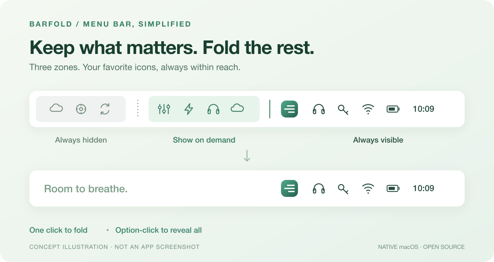

<p align="center"></p>
<h1 align="center">BarFold</h1>
<p align="center"><strong>让菜单栏，留一点呼吸的空间。</strong></p>
<p align="center">参考 Bartender 交互的原生 macOS 菜单栏管理工具。<br>常用图标留在眼前，其余收起，需要时再展开。</p>
<p align="center"><a href="README.md">English</a> · <a href="LICENSE">MIT 开源</a> · <a href="CONTRIBUTING.md">参与贡献</a> · <a href="docs/VALIDATION.md">验证状态</a></p>



*上图是功能概念示意，不是应用实机截图。*

> **Early Preview / 早期预览：** 已完成本地构建和 123 项核心检查，维护者已反馈手动启动成功，菜单栏图标和中文设置窗口正常出现。真实菜单栏交互、原生界面验收、独立代码复核尚未完成。详细边界见[验证记录](docs/VALIDATION.md)。

## 图标越来越多，菜单栏不必越来越挤

输入法、同步工具、音频设备、后台服务……每个图标都有用，但不需要每个都一直占据视线。BarFold 用三个区域，把菜单栏留给你真正经常使用的工具。

```text
始终隐藏的图标  ┊  按需展开的图标  │  BarFold 按钮  始终显示的图标
```

| 区域 | 适合放什么 | 如何显示 |
| --- | --- | --- |
| **始终显示** | 日常频繁使用的图标 | 保持可见 |
| **按需展开** | 偶尔使用的小工具 | 单击 BarFold 或按快捷键 |
| **始终隐藏** | 很少打开的后台工具 | Option + 单击，临时显示全部 |

以上行为已在源码实现，仍需在真实设备上验证。

## 已实现的功能

- **单击收起 / 展开**，Option + 单击显示全部。
- **全局快捷键**：默认 Control + Option + B；支持另外两组预设，也可关闭。
- **可选悬停展开**：停留约 0.45 秒后展开。
- **自动收起**：支持 5、10、20、30、60 秒；整理图标、使用菜单、打开设置等交互期间暂停。
- **中文原生设置**：支持浅色、深色、跟随系统，设置保存在本机。
- **可选登录启动**：默认关闭，使用 macOS 原生登录项。
- **恢复入口**：再次打开应用，展开全部图标并回到整理界面。

使用 Swift、AppKit 和 SwiftUI。应用无第三方依赖、账户、网络请求或遥测。

## 两条命令，从源码构建

需要 **macOS 14+** 和提供 **Swift 6** 的 Apple Command Line Tools。输出为本机架构，无需完整 Xcode 项目或下载依赖。

```bash
git clone https://github.com/Akkao114/BarFold.git && cd BarFold
./build.sh
```

在 Finder 中打开 `dist/BarFold.app`。本地构建使用 **ad hoc 临时签名**，未使用 Developer ID 签名，也未公证。当前发布的是源码预览，还没有已验证的安装包正式版本。

运行核心检查：

```bash
./test.sh
```

## 整理你的菜单栏

1. 打开 BarFold。首次启动显示设置，并展开全部区域。
2. 点击「**开始整理**」。
3. 按住 **⌘ Command** 拖动屏幕顶部的真实图标，按需放入对应区域。保持从左到右为 **┊、│、BarFold 按钮**。
4. 点击「**完成整理**」。应用在收起前检查分隔线顺序。

单击按钮展开 / 收起，**⌥ Option + 单击**显示全部。右键可进入整理、设置或退出。退出时移除分隔项，图标可恢复显示。登录时启动默认关闭，建议先将应用放在长期保留的位置再手动启用。

## 当前边界

- 在原菜单栏展开，**没有第二栏**。刘海屏、过长的应用菜单仍可能遮挡图标。
- 某些系统图标不允许拖动；新启动的菜单栏图标可能需要重新整理。
- macOS 14 是最低构建目标，不代表所有系统版本已验证。多显示器热插拔、睡眠唤醒和登录项注册仍待实测。

菜单栏收起通过 `NSStatusItem` 宽度实现。悬停只在开启时监听鼠标移动；自动收起检查光标、鼠标按键及窗口层级，不读取窗口标题或画面。更多信息见[实现与验证](docs/VALIDATION.md)。

## 一起把它做成更顺手的 Mac 工具

当前最需要的是**真实设备测试报告、英文界面本地化和原生交互修复**。欢迎提交 [Bug](https://github.com/Akkao114/BarFold/issues/new?template=bug_report.md) 或[功能建议](https://github.com/Akkao114/BarFold/issues/new?template=feature_request.md)，参与代码贡献请看 [CONTRIBUTING.md](CONTRIBUTING.md)。

**如果你也想要一个清爽、原生、开源的菜单栏工具，欢迎点个 Star，让更多人发现 BarFold。**

## 致谢与许可证

交互参考 [Bartender](https://www.macbartender.com/Bartender6/)，实现边界参考 [Hidden Bar 架构说明](https://github.com/dwarvesf/hidden/blob/develop/docs/ARCHITECTURE.md)。源码与视觉素材均为本项目实现，未复制参考项目的代码或素材。BarFold 是独立项目，与 Bartender 无从属关系。

采用 [MIT 许可证](LICENSE)，欢迎使用、修改和贡献。
